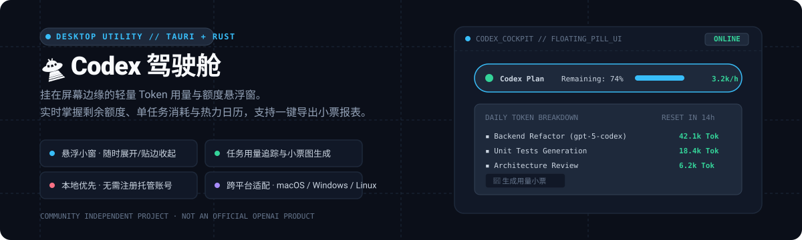

# 🛸 Codex 驾驶舱

### 让 AI 放手干活，让你心里有数。

还剩多少额度？今天用了多少？哪个任务最能消耗 Token？ 
把这些问号，装进屏幕边缘的一个轻量悬浮小窗里。

  <a href="https://github.com/HouSiyuan2001/codex-cockpit/releases/latest"><strong>⬇️ 下载 Mac / Windows 版</strong></a> ·
  <a href="https://codex-cockpit.pages.dev/"><strong>✨ 在线交互预览</strong></a> ·
  <a href="https://www.bilibili.com/video/BV1SXbv6REWz/"><strong>🎬 演示视频</strong></a> ·
  <a href="docs/README.en.md"><strong>English Docs</strong></a>

---

## 你的 Codex 桌面管家 🐾

让 Codex 写代码、改论文或推进项目时，最繁琐的事莫过于频繁切换窗口翻看控制台、核算 Token 用量。

Codex 驾驶舱替你把这些指标规整好：平时它是一只安静贴在屏幕边缘的小胶囊悬浮窗，需要时点击展开，就能看清今日消耗、重置倒计时与剩余余量。减少“额度会不会突然耗尽”的不确定感，留出更多专注工作的时间。

> **说明**：本项目为独立开源社区项目，非 OpenAI 官方产品。

---

## 核心功能特色

### 1. 🔋 余量状态一目了然
剩余额度百分比、配额重置倒计时与今日消耗进度集成在同一视图中。是继续全力推进，还是留存额度给明天的任务，无需在浏览器后台来回翻页。

### 2. 🍪 单任务用量与模型分析
按具体任务和模型维度查看 Token 实际消耗量与预估成本；配合日历热力图，回溯你与 AI 共同完成的工作节奏。

### 3. 🧾 工作用量小票一键导出
支持勾选多个已完成任务，将累计用量与估算花费生成复古小票风格的 PNG 图片。无论是整理周报、汇报项目开销，还是留作阶段归档，都简单顺手。

### 4. 🌈 把握舒适的工作节奏
直观记录各时段的使用强度，配合自主设置的计划与提醒，摸索出适合自己的协作节奏。数据旨在提供参考，而非制造焦虑。

### 5. 🏡 本地存储优先，支持小团队同步
所有数据默认仅保存在本机，无需注册额外账号，也无需自建服务器。当需要多台设备数据汇总，或与信任的团队伙伴共享用量时，可自由开启基于 Cloudflare 的轻量团队同步通道。

---

## 两步安装与快速上手

1. 打开 [最新版本下载页 (Releases)](https://github.com/HouSiyuan2001/codex-cockpit/releases/latest)：
   - **macOS**：选择 `universal.dmg`；
   - **Windows (x64)**：选择 `x64-setup.exe`。
2. 安装后启动应用，即可直接读取本机统计数据。云同步功能属于可选特性，按需开启即可。

后续如需更新，可在应用内点击「设置 ➔ 应用更新」检查新版本；下载完成后需由用户手动确认重启应用以完成替换。

> **安装提示**：当前 macOS 安装包尚未加入 Apple 公证，Windows 安装包尚未附加商业发布者证书。请务必核对官方下载来源，不要随意关闭操作系统安全保护。界面内展示的费用数字基于公开模型单价估算，不代表官方计费账单。

[📖 完整使用指南](docs/USER-GUIDE.md) · [🔒 隐私与数据说明](docs/PRIVACY.md) · [💬 问题反馈与建议](https://github.com/HouSiyuan2001/codex-cockpit/issues)

---

## 支持与投喂 ☕

如果 Codex 驾驶舱切实帮您节省了翻查记录的时间、带来了一份从容，欢迎请作者喝一杯咖啡。所有功能均完全开放，不会因是否赞赏而有任何差异。

  

---

## 开发者与高级配置资料

🛠️ 开发者、AI 协同与小团队部署文档

- [开发文档总导航](docs/README.md) · [代码贡献指南](.github/CONTRIBUTING.md) · [AI 协同协作约束 (AGENTS.md)](AGENTS.md)
- **多端同步机制**：团队同步需由管理员在个人的 Cloudflare 账号下通过 Worker 独立部署，成员通过邀请链接加入；项目方不提供公共集中托管服务。同步设计适合互相信任的小型团队，非公开注册的公共 SaaS 服务。任务名称与敏感路径默认不参与同步。
- [Cloudflare 部署指南](skills/cloudflare-sync/SKILL.md) · [自动更新机制说明](docs/AUTO-UPDATE.md)

---

本项目基于 [Quota Float](https://github.com/silverlion2/quota-float) 演进开发，遵循 [MIT 许可证](LICENSE)。特别致谢上游作者与开源依赖维护者。[第三方开源声明](docs/THIRD_PARTY_NOTICES.md)
